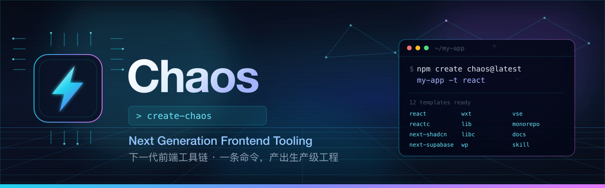

<div align="center">
  
</div>

<div align="center">

[](https://www.npmjs.com/package/create-chaos)
[](https://www.npmjs.com/package/create-chaos)
[](./LICENSE)

[简体中文](./README.md) | **[English](./README.en.md)**

</div>

# Chaos ⚡

> Next Generation Frontend Tooling, designed to accelerate and simplify frontend development.

Chaos is a CLI scaffolder. One command produces a production-shaped project —
correct tooling, correct structure, correct defaults — instead of a `npm init`
shell you have to finish yourself.

```bash
npm create chaos@latest my-app -- --template react
```

## 📋 Table of Contents

- [Why Chaos](#-why-chaos)
- [Installation](#-installation)
- [Usage](#-usage)
  - [Interactive mode](#interactive-mode)
  - [Templates &amp; short commands](#templates--short-commands)
  - [Web Composer](#web-composer)
  - [Custom templates](#custom-templates)
  - [Skills](#skills)
- [CLI reference](#-cli-reference)
- [Requirements](#-requirements)
- [Project structure](#-project-structure)
- [Documentation](#-documentation)
- [Contributing](#-contributing)
- [License](#-license)

## ✨ Why Chaos

- **🚀 One command, done properly** — every template ships with Biome, TypeScript
  and a `.gitignore` already configured. No manual setup.
- **🧠 Curated, not scraped** — 12 templates across React, Next.js, libraries,
  browser extensions, VS Code extensions, monorepos and docs sites, each proven
  in real projects.
- **🖥️ Visual composer** — a local web UI to browse templates, configure the
  output and see the equivalent CLI command before you generate.
- **🔌 Extensible** — reuse any local directory as a template via a config file.
- **📦 Tiny** — the CLI inlines its own dependencies, so the tarball has no
  install-time dependency tree beyond `c12`.
- **🌍 Bilingual composer** — the visual composer speaks both Chinese and English.

## 📦 Installation

You do not need to install anything globally. Use your favourite package
manager's `create` command:

```bash
# npm
npm create chaos@latest

# pnpm
pnpm create chaos

# yarn
yarn create chaos

# bun
bun create chaos
```

Or install the binary globally if you prefer:

```bash
npm install -g create-chaos   # provides both `create-chaos` and `chaos`
```

## 🚀 Usage

### Interactive mode

Run without arguments and answer the prompts:

```bash
npm create chaos@latest
```

You will be asked for a project name, then to pick a template from a single
grouped list. If the target directory already exists and is not empty, Chaos
asks before removing anything.

Passing **both** a project name and a template skips the prompts entirely:

```bash
npm create chaos@latest my-app --template react
```

> With npm 6, no extra `--` is needed. With npm 7+ and yarn/pnpm, pass flags
> directly.

Use `.` as the project name to scaffold into the current directory:

```bash
npm create chaos@latest . --template lib
```

### Templates & short commands

Every template has a long name and a short alias. Either works with
`--template` / `-t`.

| Category | Template | Short | What you get |
| --- | --- | --- | --- |
| **React** | `react-ts` | `react` | Vite + React + TypeScript app |
| | `react-component-ts` | `reactc` | Single React component with scoped Sass |
| **Next.js** | `react-next-shadcn` | `next-shadcn` | Next.js App Router + Tailwind + shadcn/ui |
| | `react-next-supabase` | `next-supabase` | Next.js + Supabase SSR auth + Tailwind + shadcn/ui |
| **Browser** | `browser-extension-wxt` | `wxt` | WXT cross-browser extension with React |
| **Library** | `library-ts` | `lib` | Publishable TypeScript library (tsup) |
| | `library-react-component-ts` | `libc` | React component library + playground |
| **Webpack** | `webpack-plugin` | `wp` | Typed Webpack plugin + runnable demo |
| **VS Code** | `vscode-extension` | `vse` | VS Code extension with React webview |
| **Repo** | `monorepo` | `monorepo` | pnpm workspace monorepo |
| **Docs** | `docs` | `docs` | Next.js + Fumadocs documentation site |
| **Skill** | `skill` | `skill` | Agent skill package |
| **Others** | `custom` | — | Build from your own local template |

```bash
# Vite + React app
npm create chaos@latest my-app -t react

# VS Code extension
npm create chaos@latest my-ext -t vse

# Docs site
npm create chaos@latest my-docs -t docs
```

### Web Composer

A local, dependency-free web UI for browsing templates and configuring output:

```bash
npm create chaos@latest web

# Start without opening a browser, on a fixed port
npm create chaos@latest web --no-open --port 4173

# Pre-fill the output directory
npm create chaos@latest web my-app
```

The composer:

- speaks **Chinese and English**, switchable at runtime;
- shows the **equivalent CLI command** for the current selection, so anything you
  build visually you can reproduce in a script;
- resolves output paths from the **exact directory you started the command in**,
  and only ever writes to its **child directories** (no `.`, no `..`, no absolute
  paths, no symlink escapes);
- asks for explicit confirmation before replacing existing files.

It binds to `127.0.0.1` only, and requires a per-session token, so it is not
reachable from other machines on your network.

### Custom templates

Point Chaos at any local directory. Add a `chaos.config.[js|mjs|cjs|ts]` file or
a `chaos` field in `package.json`:

```jsonc
// package.json
{
  "chaos": {
    "template": [
      { "name": "gallery", "path": "../../templates/gallery" }
    ]
  }
}
```

```ts
// chaos.config.ts
export default {
  template: [
    {
      name: 'config gallery',
      path: '../../../gallery',
      ignore: ['node_modules', '.git'],
      renameFiles: { 'README.md': 'README.zh.md' },
      replace: (file, content, packageName) =>
        file === '_gitignore' ? `${content}\nchaos` : content,
    },
  ],
};
```

Then:

```bash
npm create chaos@latest my-app --custom
```

Pass the configured name to skip the picker. Both forms work:

```bash
npm create chaos@latest my-app --custom gallery
npm create chaos@latest my-app -t gallery --custom
```

When both `package.json#chaos` and a `chaos.config.*` file exist, the configs are
merged. See [docs/custom-templates.md](docs/custom-templates.md) for the full
option reference.

### Skills

Ship an agent skill (an instruction package with a `SKILL.md`) instead of an app:

```bash
npm create chaos@latest my-skill --skill
```

## 🔧 CLI reference

```
Usage: create-chaos [OPTION]... [DIRECTORY]

Options:
  -t, --template NAME        use a specific template
  -c, --custom               create from a local custom template
  -s, --skill                create a skill project
  -w, --web                  open the visual template composer
      --port NUMBER          use a specific composer port
      --no-open              start the composer without opening a browser
  -h, --help                 display this help
```

Examples:

```bash
create-chaos                              # fully interactive
create-chaos my-app -t react              # non-interactive
create-chaos . -t lib                     # scaffold into the current directory
create-chaos my-app --custom              # from a local template
create-chaos my-skill --skill             # a skill package
create-chaos web --port 4173              # visual composer
```

## 📋 Requirements

| Requirement | Version |
| --- | --- |
| Node.js | **>= 24.0.0** (required by the CLI and every template) |
| pnpm / npm / yarn / bun | any recent version |

The CLI detects your package manager from the `npm_config_user_agent` and prints
the matching install/run commands.

## 🏗️ Project structure

```
chaos/
├── assets/                          # README banner (SVG source + PNG)
├── docs/                            # extended documentation
├── packages/
│   └── create-chaos/                # the published CLI package
│       ├── src/
│       │   ├── index.ts             # argument parsing and prompt flow
│       │   ├── config.ts            # the single source of truth for templates
│       │   ├── core/                # command execution and context
│       │   ├── commands/            # template / custom / skill / web
│       │   └── web/web-app.ts       # the visual composer UI
│       └── templates/               # everything that gets copied into projects
└── scripts/                         # release and verification scripts
    ├── verify-pack.mjs              # assert the npm tarball is publishable
    └── render-banner.mjs            # render the README banner from SVG
```

## 📚 Documentation

| Document | Contents |
| --- | --- |
| [docs/usage.md](docs/usage.md) | End-to-end usage guide for every mode |
| [docs/templates.md](docs/templates.md) | What each template contains |
| [docs/custom-templates.md](docs/custom-templates.md) | Reusing your own templates |
| [docs/development.md](docs/development.md) | Local development, adding a template |
| [docs/publishing.md](docs/publishing.md) | How releases are versioned and published |

## 🤝 Contributing

```bash
git clone https://github.com/chaos-design/chaos.git
cd chaos
pnpm install
pnpm run build
```

| Command | Purpose |
| --- | --- |
| `pnpm run build` | Build the CLI with unbuild |
| `pnpm run typecheck` | Type-check the CLI sources |
| `pnpm run lint` | Biome check |
| `pnpm run format` | Biome format |
| `pnpm run verify:pack` | Assert the npm tarball is publishable |
| `pnpm run verify:custom` | Check `--custom` error handling and renames |
| `pnpm run banner` | Re-render the README banner from SVG |
| `pnpm test` | typecheck + lint + verify:pack + verify:custom |

Formatting and linting use [Biome](https://biomejs.dev/). Please read
[CONTRIBUTING.md](CONTRIBUTING.md) before opening a pull request.

## 📄 License

[MIT](./LICENSE) © Chaos Design