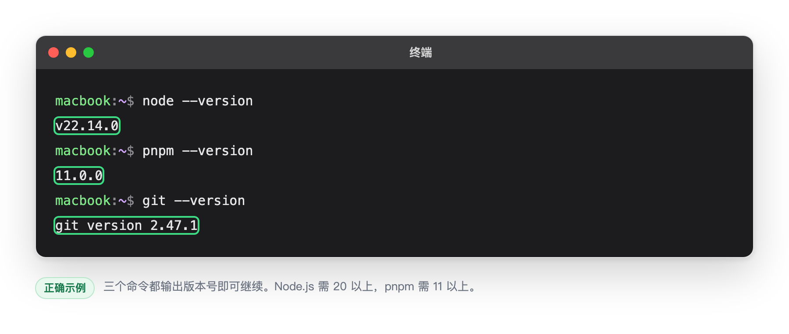
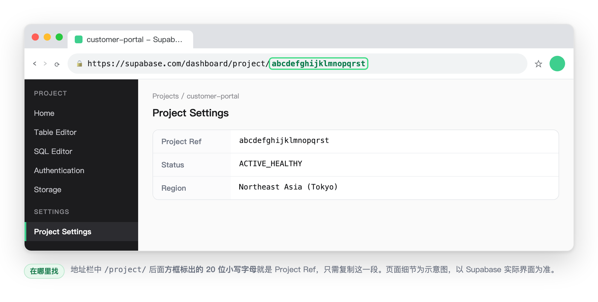
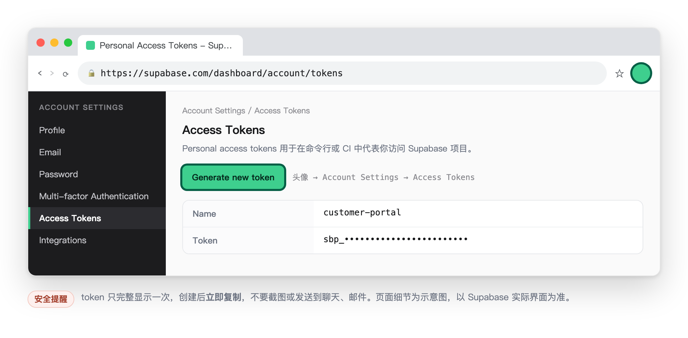
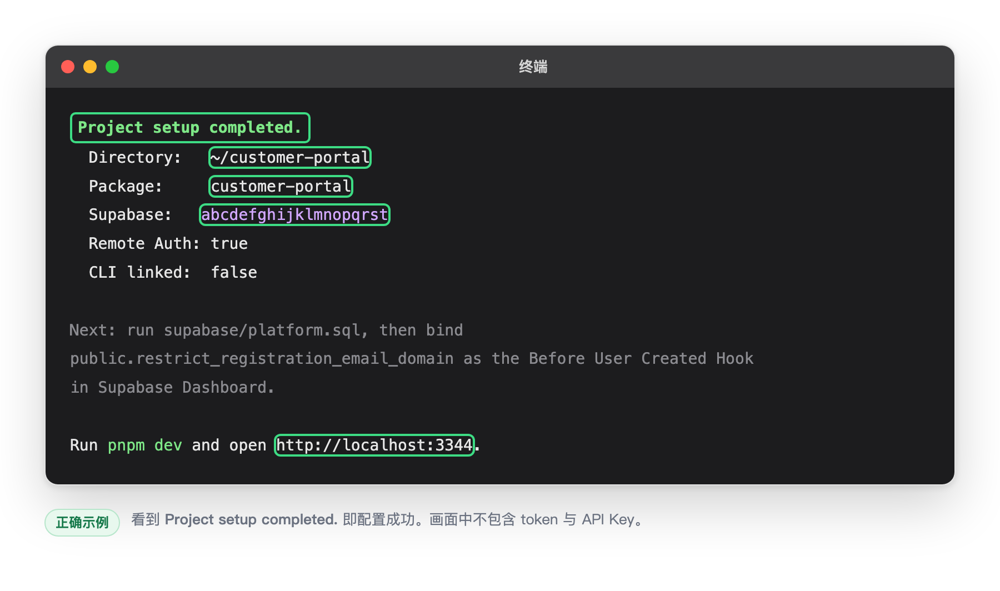
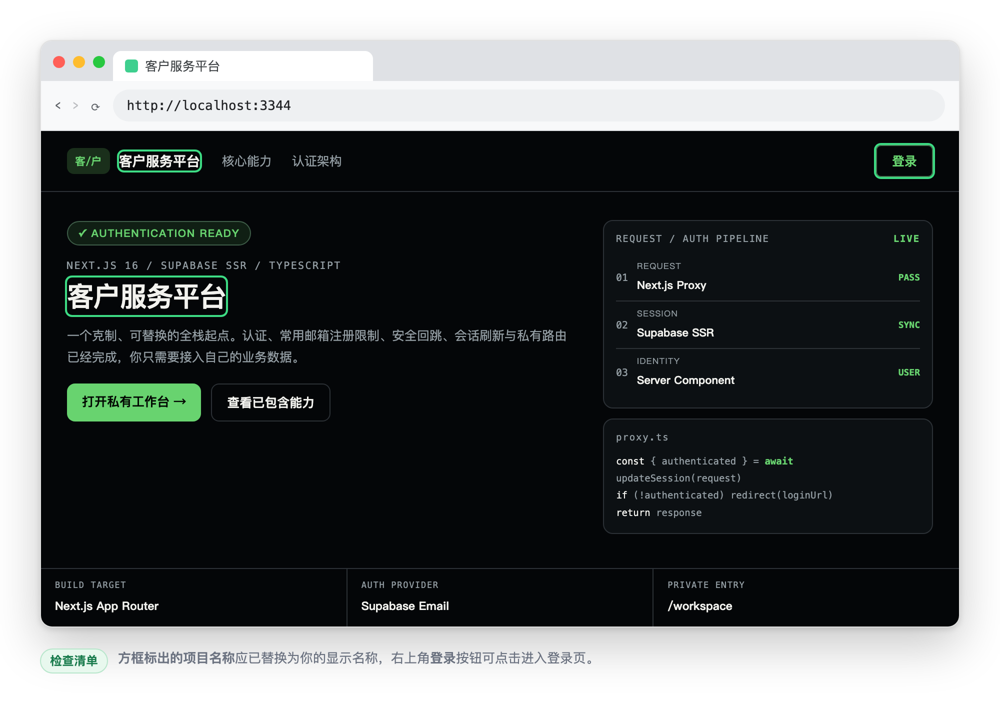

# 非技术人员简易操作手册

[中文](./non-technical-quick-start.md) | [English](./non-technical-quick-start.en.md)

本手册用于把模板快速配置成自己的项目。全程只需要操作 Supabase 网页、
复制终端命令并修改少量文字。

> 本手册中的界面图片均为**示意图**，使用示例项目名 `customer-portal`、示例 Project Ref
> `abcdefghijklmnopqrst` 和脱敏内容，用来说明“应该看到什么”。真实界面以 Supabase 和
> 浏览器实际显示为准，版本号、按钮位置等细节可能随官方改版变化。

## 开始前准备

请先向技术负责人确认以下内容：

- 模板仓库的 HTTPS 地址。
- 项目英文名，例如 `customer-portal`，只能使用小写字母、数字和短横线。
- 项目显示名称，例如“客户服务平台”。
- 一个已经创建好的 Supabase 项目。
- Supabase 项目的 20 位 Project Ref。
- Supabase Personal Access Token。

电脑需要已经安装 Node.js 20+、pnpm 11 和 Git。打开“终端”后执行：

```bash
node --version
pnpm --version
git --version
```

三个命令都能显示版本号即可继续。出现“command not found”时，请让技术人员先安装对应工具。



> **截图 1：环境检查**
>
> 画面应包含 `node`、`pnpm` 和 `git` 三个版本号。
>
> 不要出现电脑用户名、目录中的个人信息。

## 第一步：下载模板

复制下面整段命令到终端。只修改前两行引号里的内容：

```bash
TEMPLATE_REPO="https://github.com/your-org/your-starter.git"
PROJECT_FOLDER="customer-portal"

git clone "$TEMPLATE_REPO" "$PROJECT_FOLDER"
cd "$PROJECT_FOLDER"
```

执行完成后，终端最后不应出现红色错误。

## 第二步：获取 Supabase 信息

### 获取 Project Ref

1. 登录 [Supabase Dashboard](https://supabase.com/dashboard)。
2. 点击要使用的项目。
3. 查看浏览器地址，例如：

```text
https://supabase.com/dashboard/project/abcdefghijklmnopqrst
```

最后的 20 位小写字母 `abcdefghijklmnopqrst` 就是 Project Ref。



> **截图 2：Project Ref**
>
> 画面应包含 Supabase 项目页面顶部和浏览器地址栏，用方框标出地址中 `/project/` 后面的
> 20 位字母。
>
> 不要出现 API Key、数据库密码或用户数据。

### 创建 Personal Access Token

1. 点击 Supabase 页面右上角头像。
2. 进入 **Account Settings**。
3. 打开 **Access Tokens**。
4. 点击 **Generate new token**。
5. 名称填写项目英文名，创建后立即复制 token。



> **截图 3：创建 Access Token**
>
> 画面应包含 **Account Settings > Access Tokens** 页面，用方框标出
> **Generate new token** 按钮。
>
> 不要出现生成后的 token。token 只会完整显示一次，也不要发送到聊天或邮件。

## 第三步：一键配置

先在终端设置项目资料。只修改等号右侧引号中的内容：

```bash
PROJECT_NAME="customer-portal"
DISPLAY_NAME="客户服务平台"
PROJECT_REF="abcdefghijklmnopqrst"
```

页面左上角的品牌缩写会根据 `DISPLAY_NAME` 自动生成，不需要额外设置。
`客户服务平台` 会生成 `客/户`。

然后输入以下命令：

```bash
read -s SUPABASE_ACCESS_TOKEN
export SUPABASE_ACCESS_TOKEN
```

终端等待输入时，粘贴刚才复制的 Access Token，然后按回车。输入过程没有文字显示，
这是正常现象。

继续复制执行：

```bash
pnpm setup:project -- \
  --name "$PROJECT_NAME" \
  --display-name "$DISPLAY_NAME" \
  --supabase-project-ref "$PROJECT_REF" \
  --no-link-supabase
```

等待几分钟。脚本会自动：

- 修改项目名称和页面品牌。
- 配置 Supabase 登录、邮箱验证、验证码和回调地址。
- 创建本地配置文件。
- 安装依赖并检查项目。

看到以下文字表示成功：

```text
Project setup completed.
```

为了防止他人绕过注册页面直接使用非常用邮箱注册，还需要在 Supabase Dashboard 完成：

1. 打开 **SQL Editor**，新建 Query。
2. 将项目内 `supabase/platform.sql` 的完整内容粘贴进去并执行。
3. 打开 **Authentication > Hooks**，新增 **Before User Created** Hook。
4. 选择 Postgres 函数 `public.restrict_registration_email_domain` 并保存。

最后清除终端中的临时令牌：

```bash
unset SUPABASE_ACCESS_TOKEN
```



> **截图 4：配置成功**
>
> 画面应包含终端最后约 10 行，其中有 `Project setup completed.`、项目名称和 Supabase
> Project Ref。
>
> 截图前确认画面中没有 `SUPABASE_ACCESS_TOKEN`、`sbp_` 开头的 token 或 API Key。

## 第四步：启动项目

在终端执行：

```bash
pnpm dev
```

看到 `http://localhost:3344` 后，用浏览器打开：

[http://localhost:3344](http://localhost:3344)

这里的 `3344` 是默认值；如果 `scaffold.config.json` 中的 `devPort` 已修改，请打开终端实际显示的地址。

检查以下内容：

1. 首页显示新的项目名称。
2. 点击登录可以进入登录页面。
3. 常用邮箱注册时可以收到 Supabase 验证邮件。
4. 使用 `example.com` 等非白名单域名注册时会显示错误。

停止项目时，回到终端按 `Control + C`。



> **截图 5：项目首页**
>
> 画面应包含浏览器完整页面，用方框标出新的项目名称和登录按钮。
>
> 不要出现测试账户邮箱、验证码或浏览器保存的密码。

## 遇到问题

### 提示 `command not found`

缺少 Node.js、pnpm 或 Git。把完整错误截图发给技术负责人。

### 提示 `Invalid project ref`

重新复制 Supabase 项目地址中 `/project/` 后面的 20 位小写字母。

### 提示 `Unauthorized` 或 `401`

Access Token 无效或已过期。回到 Supabase **Access Tokens** 页面重新创建，再从第三步开始。

### 页面打不开

确认运行 `pnpm dev` 的终端仍然打开，并且没有红色错误。运行 `pnpm config:show` 查看
`devPort`，再打开对应的 `http://localhost:<devPort>` 地址。

### 没有收到验证邮件

先检查垃圾邮件。仍未收到时，把终端错误和 Supabase Authentication 页面截图发给技术负责人，
但不要发送 token、API Key、密码或验证码。

## 完成标准

- 终端显示 `Project setup completed.`。
- `pnpm dev` 启动成功。
- 首页显示新项目名称。
- 登录和注册页面可以打开。
- `supabase/platform.sql` 已完整执行，Before User Created Hook 已绑定。
- 常用邮箱可以收到注册验证邮件，非常用邮箱会被拒绝。
