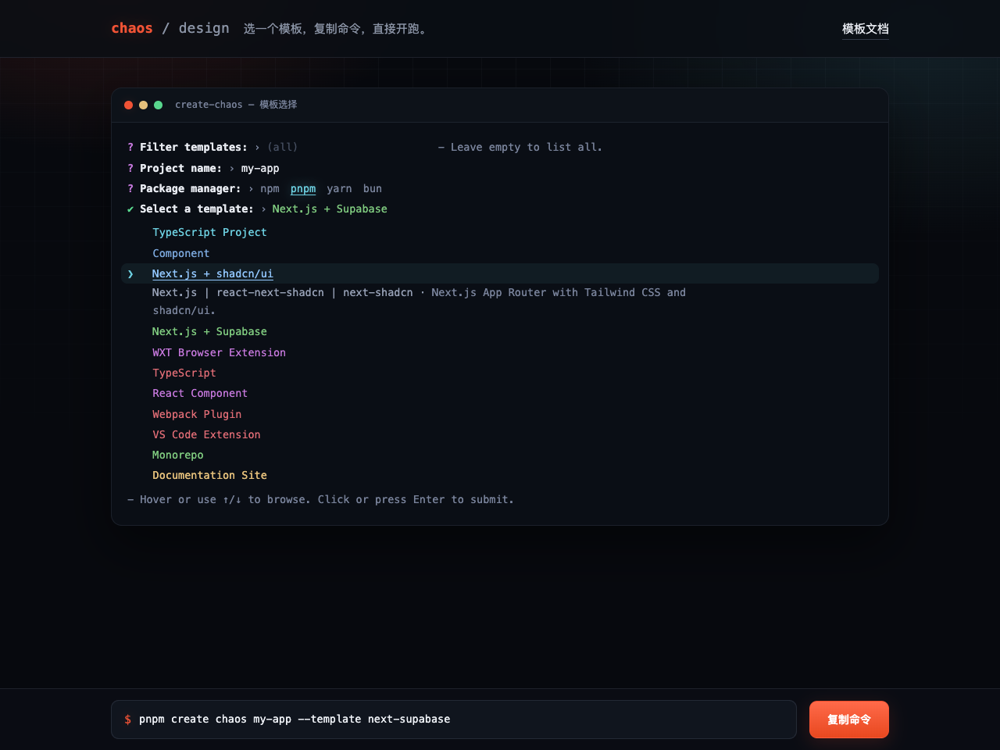
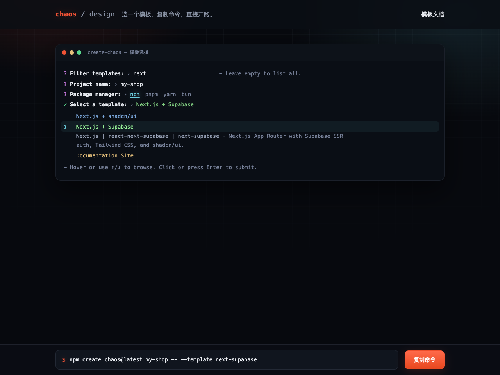

# Chaos Template Gallery

一个零依赖的静态页面：以 create-chaos CLI 终端交互的同款样式浏览全部模板，
选中后即可复制一条可直接执行的 CLI 命令，基于该模板创建项目。整站采用暗黑
科技风——深色底、工程网格、双色辉光，模板标题沿用 CLI 里真实的 kolorist
配色。



## 特性

- **终端级还原**：复刻 `prompts` 包 select 选择器的渲染规则——品红 `?` 提问
  符、粗体消息、灰色 `›` 分隔符、青色 `❯` 指针、选中后翻转为绿色 `✔`；
  指针行下方显示 `分类 | 名称 | 别名` 与模板描述，与真实脚手架交互一致。
- **CLI 真实配色**：模板数据携带 `config.ts` 中配置的 kolorist 颜色名，
  页面据此着色，标题颜色与终端里跑 `create-chaos` 时完全一致。
- **一键复制**：命令形式与仓库 README 用法一致（npm 7+ / yarn / pnpm 通过
  `--` 传参，bun 直接传参），复制后粘贴到终端即可创建项目。
- **即时筛选**：按标题 / 别名 / 分类 / 描述实时过滤，无匹配时显示黄色提示行。
- **键盘友好**：↑/↓ 移动指针、Enter 提交；所有可点元素均为原生 `<button>`，
  `aria-pressed` 标记选中态。
- **零依赖零构建**：纯静态文件，数据经 `<script>` 注入（不用 fetch），
  `file://` 协议下双击 `index.html` 同样可用。



## 快速开始

任意静态服务器均可：

```bash
# 方式一：Python（macOS / Linux 自带）
cd site
python3 -m http.server 5173
# 打开 http://localhost:5173

# 方式二：Node
npx serve site
```

也可以直接双击 `index.html` 在浏览器中打开。

## 使用方法

| 步骤 | 操作 |
| --- | --- |
| 1. 筛选模板（可选） | 在 `Filter templates:` 输入关键词 |
| 2. 项目目录 | 在 `Project name:` 填写目录名（留空回退为 `chaos-project`） |
| 3. 包管理器 | 点击 `Package manager:` 后的 npm / pnpm / yarn / bun |
| 4. 选择模板 | 悬停或 ↑/↓ 移动 `❯` 指针，点击或 Enter 提交 |
| 5. 复制执行 | 底部命令栏点击「复制命令」，粘贴到终端运行 |

命令示例（同一模板在不同包管理器下的形态）：

```bash
pnpm create chaos my-app --template next-supabase
npm create chaos@latest my-app -- --template next-supabase
bun create chaos my-app --template next-supabase
```

## 页面配置与目录结构

```text
site/
|-- index.html                 # 页面骨架（终端窗口 + 命令栏）
|-- assets/
|   |-- styles.css             # 暗黑主题：网格背景、辉光、动画与终端配色
|   |-- app.js                 # 光标移动、命令生成、复制降级逻辑
|   |-- screenshot-gallery.png # 页面截图：模板总览
|   `-- screenshot-filter.png  # 页面截图：筛选 + 命令生成
|-- data/
|   `-- templates.js           # 生成文件：模板数据（window.CHAOS_TEMPLATES）
|-- scripts/
|   `-- sync-templates.mjs     # 从 CLI 配置重新生成 data/templates.js
`-- README.md
```

### 可配置点

- **主题变量**：`assets/styles.css` 顶部的 `:root` 集中定义了背景
  （`--bg`）、面板（`--panel` / `--term-bg`）、品牌橙（`--accent`）、辉光
  （`--glow-orange` / `--glow-cyan`）与终端指针色（`--term-cursor`），改一处
  即可整体换肤。
- **kolorist 映射**：`.c-blue`、`.c-cyan`、`.c-green` 等类把 CLI 的颜色名
  映射到深色背景下的近似色值，新增颜色时补一个类即可。
- **包管理器列表**：`assets/app.js` 顶部的 `PM_ORDER` 数组，增删一行即可。
- **动效开关**：所有动画与过渡都收敛在 `prefers-reduced-motion: reduce`
  媒体查询下，偏好减弱动效时自动关闭。

## 数据同步

`data/templates.js` 由脚本从 CLI 的唯一数据源
`packages/create-chaos/src/config.ts` 的 `FRAMEWORKS` 数组生成，不会与 CLI
实际发布的模板脱节。每条记录带有 CLI 渲染标题所用的 kolorist 颜色名
（`color` 字段）。CLI 中新增、修改或删除模板后，重新生成并提交：

```bash
node site/scripts/sync-templates.mjs
```

脚本仅使用 Node 标准库。CI 或本地可用 `--check` 模式校验数据文件是否与 CLI
配置一致（不一致时以非零退出码失败）：

```bash
node site/scripts/sync-templates.mjs --check
```

## 设计说明

- **暗黑科技风**：深色底（`#07090e`）叠加 44px 工程网格与橙 / 青两团辉光；
  终端窗口带入场浮动动画；模板行悬停有青色背景渐显；命令变化时命令文本
  闪现一次青色高亮，引导视线到更新处。
- **复制三级降级**：`navigator.clipboard` → `execCommand('copy')`（`file://`
  等非安全上下文）→ 自动选中命令文本并提示按 Ctrl/⌘ + C。
- **动效尊重系统偏好**：`prefers-reduced-motion: reduce` 时关闭全部动画。
